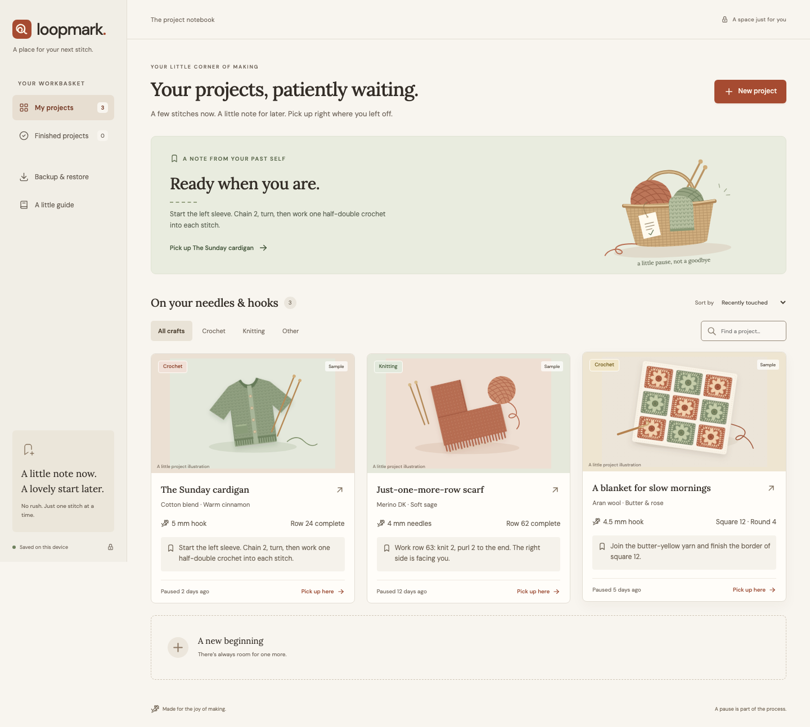

# Loopmark

**A little note now. A lovely start later.**

A complete browser-local craft project restart tool. Save where you paused, then open your project days or weeks later to see the next step immediately.



## Run locally

Requires Node.js **22.12+** (tested here with 26.8.2) and npm. Run commands inside this project folder:

```sh
npm ci
npm run dev
```

Open the URL printed by Vite, normally **http://127.0.0.1:5173**. No API keys, account, environment variables, or backend are required.

For the full offline experience, use the production build:

```sh
npm run build
npm run preview -- --port 4173 --strictPort
```

Open **http://127.0.0.1:4173**, allow the first load to finish, then the app can reopen offline. Service workers intentionally run only in production. A different hostname or port is a different browser storage location. Keep using the same URL; export/import to move data between origins or browsers.

## What works

- Create/edit projects for crochet, knitting and other crafts; search, filter, sort, finish and reopen them.
- Save immutable checkpoints with next step, row/repeat, tool size, optional photo, notes and microphone recording.
- Resume at the latest checkpoint; inspect the complete previous history.
- Download and restore a complete backup including photos and audio; validated replacement is atomic.
- Print a bag label with readable details and a locally generated QR shortcut.
- Install as a web app where the browser supports it; use core workflows offline after the production shell is cached.
- Keyboard-accessible dialogs, mobile layouts, reduced motion, local fonts and original vector artwork.

The first launch is empty. “Take a look with sample projects” adds three explicitly labeled examples only to an empty collection. The research build has no artificial project paywall. Capacity safeguards are 200 projects, 1,000 total checkpoints and 48 MiB of serialized library data.

## Using it

1. Add a project and its tool/yarn details.
2. Before putting it away, select **Save a checkpoint**. The only required checkpoint field is **What will you do next?**
3. On return, open the project: your latest instruction, row and tool are already there.
4. Download a full backup regularly from **Backup & restore**.

Recordings require microphone permission and HTTPS or localhost. They stop after two minutes and on dialog close. Photo uploads accept JPEG, PNG and WebP up to 15 MiB and are resized locally. HEIC requires conversion first. No media is uploaded.

## Data and recovery

IndexedDB belongs to a browser profile and site origin. It is not a cloud backup, an account, or device sync. Clearing site data, private browsing or browser eviction can lose it. Requesting persistent storage can help but is not a guarantee. A backup contains private notes and media; store it safely.

Restore previews project/checkpoint counts before confirmation and **replaces the entire current collection**. Download a current backup first if you need both collections. Unsupported/malformed imports leave existing data unchanged. Dates inside checkpoints remain unchanged; project update tokens refresh to prevent stale tabs overwriting restored data.

A label QR opens the same origin and project ID. It cannot transfer a project. Restore the backup on that site in the target browser first. A `localhost` label points to the computer where it is scanned and is unsuitable for sharing between devices; use a stable HTTPS origin for that use case.

## Verification

```sh
npm test                  # domain, transactions, validation, recovery
npx playwright install chromium
npm run build
npm run test:e2e           # real Chromium, built production app
npm run format:check
```

`npm run check` builds and runs both test suites. Browser tests create isolated browser contexts and synthetic fixtures. Microphone tests use Chromium's fake device; they do not establish real hardware behavior. Physical printing, mobile Safari, Android/iOS installation and real user retention remain unverified. See [verification](docs/verification.md) and the [independent review](docs/review.md) for the executed results and limits.

## Project map

- `src/App.tsx` — shell, navigation and integration
- `src/components/` — shelf, project/history, forms, voice, backup, label and guide
- `src/data.ts` / `src/types.ts` — versioned contracts, IndexedDB, strict validation, atomic mutations
- `src/media.ts` — local image processing
- `public/art/` — original editable SVG art
- `scripts/build-sw.mjs` — production precache generator
- `tests/` — browser journeys and accessibility/recovery checks
- `.github/workflows/ci.yml` — reproducible checks on push/PR

## Decisions and evidence

[Product and experiment](docs/product.md) · [Research ledger](docs/research.md) · [Release specification](docs/specification.md) · [Architecture](docs/architecture.md) · [Design system](design-system/loopmark/MASTER.md) · [Implementation plan](docs/implementation-plan.md) · [Requirement traceability](docs/requirements.md) · [Operations and deployment](docs/runbook.md) · [Skill inventory](docs/skills.md)

No deployment, paid service, marketing message or real payment processing was performed. Native apps, optional cloud sync and pricing experiments belong to the backlog. Third-party license notices are included in `public/licenses/`; original artwork was created for this project.
