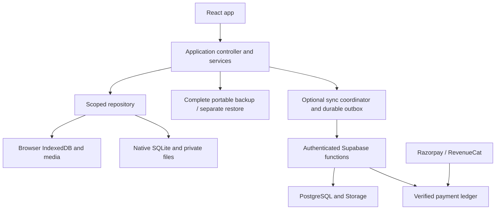

# Loopmark

**A little note now. A lovely start later.**

Loopmark helps makers restart unfinished crochet, knitting and similar craft projects. Before putting a project away, save its photo, hook or needle size, row or repeat, and the next thing to do. When you return, that checkpoint is the first thing you see.

The project includes a React web app, an offline-capable production build, Capacitor iOS and Android apps, optional Supabase account sync, Razorpay hosted web checkout, and RevenueCat native purchase adapters. **Guest use needs no account, backend or API key.**

The local implementation and recorded browser, backend and simulator/emulator verification are complete. Hosted service activation, real payment-provider qualification, signed store releases and physical-device qualification remain separate work. See [current status](#current-status-and-known-limits) before treating this repository as a production service.


*The screenshot shows optional example projects. A new installation starts empty.*

## Contents

- [Why Loopmark exists](#why-loopmark-exists)
- [Features](#features)
- [Start the guest app](#start-the-guest-app)
- [Use the app](#use-the-app)
- [Data, privacy and limits](#data-privacy-and-limits)
- [Stack and architecture](#stack-and-architecture)
- [Optional local backend](#optional-local-backend)
- [Configuration](#configuration)
- [iOS and Android](#ios-and-android)
- [Payments and purchase recovery](#payments-and-purchase-recovery)
- [Testing and verification](#testing-and-verification)
- [Hosting and operations](#hosting-and-operations)
- [Troubleshooting](#troubleshooting)
- [Project structure](#project-structure)
- [Current status and known limits](#current-status-and-known-limits)
- [Documentation](#documentation)
- [Contributing, security and licensing](#contributing-security-and-licensing)

## Why Loopmark exists

After a few weeks away from a craft project, it is easy to forget the tool size, row position, modification or next step. Loopmark is designed for makers with several unfinished projects who need a quick way to leave enough information to restart confidently.

The central interaction is small: **pause → save a checkpoint → return → follow the next step**. A project-bag label helps find the record. Earlier checkpoints help reconstruct changes. General project management is secondary to making the next restart easier.

The research and commercial assumptions remain hypotheses. The planned pilot recruits 15 makers with at least four unfinished projects and measures 10 voluntary checkpoint users, 8 restarts after a week or more, and 5 purchases. That study has not been run. See the [research protocol](docs/expansion-research-protocol.md).

## Features

| Area | Implemented behavior |
| --- | --- |
| Projects | Create, edit, search, finish and reopen projects; start empty or explicitly add labeled examples. |
| Checkpoints | Save a next-step instruction, tool size, row/repeat, photo and optional voice note; reopen the latest checkpoint and browse saved history. |
| Drafts | Keep unfinished form values on this device, explicitly discard them, and retry interrupted saves without duplicating a completed action. |
| Offline use | Save locally without an account. Production builds cache the app shell for reopening after a successful initial load. |
| Portable backup | Export saved projects, checkpoint history and complete verified media bytes as portable JSON v1. Restore into a separate recovered collection. |
| Bag labels | Print a readable project code, essential details and QR shortcut. Labels are navigation aids; they do not contain a backup. |
| Optional accounts | Sign in with an email code; review the destination and counts before explicitly connecting a local collection. Signing in alone does not move local projects. |
| Sync | Queue offline changes, retry the original operation, track text and attachment completion separately, and review conflicts while retaining recoverable work. |
| Offline attachments | Check whether project files are available locally, download missing files, or remove eligible downloaded copies without removing cloud data or protected originals. |
| Native file opening | Review an externally opened backup before restoring. Durable import identity prevents repeated OS delivery from creating duplicate recoveries. |
| Account lifecycle | Review local-copy choices before sign-out or deletion; retain a private read-only deletion receipt for checking progress afterward. |
| Purchases | Three active projects free; server-verified one-time access allows more active projects within technical limits. Web/native adapters support pending, cancellation, restore and recovery flows. |

Reaching the free allowance never hides existing projects, editing, checkpoint capture, saved history or export. It gates creating or reopening additional active projects. Eligible migrated collections retain their established access; importing a backup does not create a purchase grant.

## Start the guest app

### Prerequisites

- Node.js **22.12 or newer**, npm and a modern browser. The contributor guide uses Node 24 LTS as its baseline recommendation.
- Git for cloning the repository.
- Network access for the initial dependency installation. The committed lockfile controls exact dependency resolution.

```sh
git clone https://github.com/satishTheLegend/loopmark.git
cd loopmark
npm ci
npm run doctor -- --capability guest --json
npm run dev
```

Open the loopback URL printed by Vite. The default port derives from the checkout path; use `LOOPMARK_DEV_APP_PORT` if an explicit port is needed. Stop the development server with Ctrl-C. Run subsequent commands from this project directory.

No `.env.local` is required for guest use. `doctor` inspects prerequisites; it does not change data or certify app behavior. Exit `0` means the requested prerequisites are ready, `2` means missing configuration/tools, and `3` means an unhealthy or occupied local resource.

### Try production and offline behavior

```sh
npm run build
npm run preview -- --port 4173 --strictPort
```

Open **http://127.0.0.1:4173**. After an online load, open **A little guide** and confirm “Ready offline on this device.” Then disconnect and reopen the same address. The service worker is enabled in production builds, not the development server.

Keep the same origin and browser profile. `localhost`, `127.0.0.1`, different ports and different profiles each have separate storage. A new origin can appear empty even though the original data remains at the old one.

## Use the app

1. **Start a project.** Give it a recognizable name and record the craft details you need.
2. **Pause with a checkpoint.** Choose **Save a checkpoint**. The required field is **What will you do next?** Add a current photo, tool size, row/repeat or voice note as useful.
3. **Return later.** Open the project and follow the latest next step. Browse older checkpoints when you need to reconstruct a change.
4. **Check offline files.** For a connected project, use **Project files** before leaving a connection. A saved note and a downloaded attachment have separate availability states.
5. **Back up.** Export a complete backup and keep it outside the app. Restore it in a separate browser profile to verify recovery independently of the original installation.

Photos are resized locally. Browser recording requires microphone permission and HTTPS or localhost, and stops after two minutes. Native capture uses platform permission and interruption handling. Permission denial and missing media produce recovery guidance instead of a successful-save claim.

A printed bag label captures the current facts. A localhost QR points to the scanning device's own localhost, so it is not a cross-device sharing link. Cross-device labels need a stable configured HTTPS origin and access to the matching record.

## Data, privacy and limits

### Where work is stored

| Mode | Storage and transfer |
| --- | --- |
| Guest browser | Projects, checkpoints, drafts and local media use this browser's storage. No account or cloud enrollment is needed. |
| Guest native | SQLite stores craft metadata; private platform files store media. Native credentials, when used, go through secure platform storage. |
| Connected collection | Local changes remain durable first, then sync with the configured authenticated backend. Media uploads only for a collection explicitly connected by the user. |
| Portable backup | A user-owned JSON file includes saved project content and media. It is not encrypted by Loopmark. |
| Service recovery | Separate operator tooling snapshots database and object bytes into encrypted recovery files. Its local implementation shares the host's failure domain. |

Signing in is separate from connecting a collection. A purchase can enable more local projects while the collection remains local. Removing eligible downloads affects that device's cache; cloud attachments, local originals and files needed by unfinished operations remain protected.

### Backup and restore guarantees

- Export includes saved projects, checkpoint history and all referenced photo/voice bytes. Missing or corrupt required bytes cause export to fail with recovery guidance.
- **Drafts are not included.** Save unfinished drafts as projects/checkpoints before exporting them.
- Restore validates the file and creates a **separate recovered collection**, preserving the original collection and its drafts.
- Portable files exclude account ownership, credentials, purchase grants, queued sync commands and account recovery capabilities.
- Purchase recovery keys and deletion receipt capabilities are private account tools. They do not replace a craft-data backup.
- Browser storage may be evicted or cleared; uninstalling a native app can remove its local data. Sync and QR labels do not replace an independent exported backup.

### Technical limits

| Limit | Value |
| --- | --- |
| Free active projects | 3; additional create/reopen actions need verified access |
| Projects per collection | 200 |
| Checkpoints per collection | 1,000 |
| Serialized portable project content per collection | 48 MiB, including encoded photos/audio |
| Complete portable file | 50 MiB maximum; native incoming staging is also bounded at 50 MiB |
| Browser voice recording | Up to 2 minutes |
| Concurrent media work | Default 2; configurable from 1 to 4 |

The size limit applies to serialized content, so an original photo's file size is not the only relevant measurement. Cloud quota accounting includes staged uploads and replacement reservations. See [domain policy](src/domain/policy.ts), [portable validation](src/domain/portable-schema.ts) and [version rules](docs/developer/migrations.md).

## Stack and architecture

| Layer | Technology and responsibility |
| --- | --- |
| Interface | React 19, TypeScript and Vite; self-hosted DM Sans/Lora fonts, Tabler icons and editable SVG artwork |
| Domain | Zod validation, portable JSON v1, sync protocol v2, explicit capacity and entitlement policy |
| Browser persistence | IndexedDB repositories, scoped drafts, durable workflow records and a static-asset service worker |
| Native shell | Capacitor 8, SQLite, private filesystem, secure credential storage, camera/audio/share/lifecycle adapters |
| Optional backend | Supabase Auth, PostgreSQL, Storage and Edge Functions; committed migrations and authorization boundaries |
| Payments | Razorpay hosted Payment Links for web; RevenueCat adapters for Apple/Google purchases; server-owned entitlement ledger |
| Verification | Vitest, Playwright, axe accessibility checks, real local backend suites and native simulator/emulator harnesses |



Browser and native implementations share domain and repository contracts. Account, collection and generation scopes fence asynchronous work so an old completion cannot overwrite a newly selected collection. Attempted sync commands retain their original identity and payload hash on retry. Conflicts and replacement previews require explicit review; incomplete candidates are not exposed as empty successful replacements.

Payment redirects and SDK success are evidence to reconcile, never direct entitlement grants. Cloud APIs bypass the service worker cache. Public configuration is validated before bundling, and private app routes retain indexing protections.

The [engineering design](docs/expansion-engineering.md), [contract reference](docs/developer/contracts.md) and [runtime](src/runtime.ts) describe these boundaries in detail.

## Optional local backend

Guest use does not need Docker. To exercise actual account, sync, media and server behavior, install a Docker-compatible runtime with a local socket and use a unique profile for this checkout:

```sh
export LOOPMARK_DEV_PROFILE=craft-dev
npm run doctor -- --capability local-sync --json
npm run local:up
npm run local:status
npm run dev
```

The first doctor may report that the profile is not prepared. `local:up` uses the project-pinned Supabase CLI, creates isolated configuration, applies migrations and writes public browser settings to ignored `.env.local`. It also starts the independent local erasure ledger. Cold image downloads can take several minutes. The launcher refuses occupied ports and remote operator targets.

Use synthetic email addresses. Find delivered codes in the local Mailpit instance at the `mail` port reported by doctor. To verify sync, sign into two independent browser profiles, explicitly connect a collection, save offline on one, reconnect and check that the other receives the checkpoint exactly once. Check attachment completion separately.

For the complete backend and browser integration suites, stop the interactive Vite server and enable the isolated synthetic billing provider on the same profile. Purchase cases require this fixture; ordinary guest or sync use does not.

```sh
npm run local:up -- --billing-fixture
npm run test:server -- --suite all
LOOPMARK_SYNC_PUBLIC_ENV="$PWD/.env.local" npm run test:sync
```

The sync runner starts its own server on the selected app port and requires the explicit public env file. These fixtures are for the owned local stack and synthetic accounts, never a production account. The synthetic billing fixture makes no real provider purchases and is not provider sandbox qualification.

Stop services while preserving their data:

```sh
npm run local:down
```

For an intentional reset, export useful data and obtain the exact `projectId` from doctor. Then use `npm run local:reset -- --confirm-project <exact-local-project-id>`, replacing the placeholder. Reset erases that local database; it does not clear browser databases or the independent erasure ledger. Do not reset a profile another contributor is using. Full instructions are in the [local quickstart](docs/developer/quickstart.md).

## Configuration

Start with [.env.example](.env.example) and copy only needed values into ignored `.env.local`. Explicit process environment values override the file. No environment file is necessary for guest mode.

| Public build variable | Purpose |
| --- | --- |
| `VITE_LOOPMARK_APP_ORIGIN` | Exact HTTPS app origin, or HTTP loopback during local development |
| `VITE_LOOPMARK_SUPABASE_URL` | Exact backend origin; cloud requires this together with the app origin and public key |
| `VITE_LOOPMARK_SUPABASE_ANON_KEY` | Supabase publishable or legacy anon key; never a service-role or secret key |
| `VITE_LOOPMARK_MEDIA_CONCURRENCY` | Integer 1–4, default 2 |

All public build values are visible in shipped assets. Server credentials, payment secrets and the erasure-ledger key belong only in the server environment. `LOOPMARK_PUBLIC_SUPPORT_EMAIL` supplies a public mailbox for generated help pages and should contain only the intended public contact.

Cloud and payment enrollment default off. Setting a secret does not activate a service. The `LOOPMARK_CLOUD_ENROLLED`, `LOOPMARK_RAZORPAY_ENROLLED` and `LOOPMARK_REVENUECAT_ENROLLED` flags are independent server controls; sandbox and production payment environments remain distinct.

Auth callbacks derive from the validated app origin plus `/auth/callback`. Configure the exact callback rather than a wildcard. Native links require platform-specific registration and qualification. See [configuration boundaries](docs/developer/configuration.md) for all profile, port and server settings.

## iOS and Android

The committed application ID is `app.loopmark.craft`. Native guest capture works without cloud or payment configuration. Complete the guest setup first and use the project-pinned dependencies.

### iOS simulator

Requires macOS, a compatible selected Xcode toolchain and an installed iOS simulator runtime. Dependencies resolve through Swift Package Manager.

```sh
npm run doctor -- --capability native-ios --json
npm run native:sync
npm run native:ios:build
```

The normal build produces an unsigned simulator Debug app under `ios/build`. Open `ios/App/App.xcodeproj` to run it on a test-owned simulator. Physical-device signing, entitlements, App Store Connect and distribution are separate prerequisites.

### Android emulator

Requires Java 21, Android SDK platform/build tools for API 36 and an emulator image. Set `LOOPMARK_JAVA_HOME` or `JAVA_HOME`, and `ANDROID_HOME` or `ANDROID_SDK_ROOT`, to their actual locations. Review and accept SDK licenses through the Android tooling yourself.

```sh
npm run doctor -- --capability native-android --json
npm run native:sync
npm run native:android:build
```

The build produces `android/app/build/outputs/apk/debug/app-debug.apk`. Open `android/` in Android Studio to run on an authorized emulator. The committed minimum SDK is 24 and compile/target SDK is 36; those settings do not establish qualification on every corresponding physical device.

### Native verification

The dedicated native test harness installs synthetic assets using the same application ID. Use only disposable, test-owned targets without personal craft data. The [native guide](docs/developer/native.md) explains the harness build, explicit `LOOPMARK_IOS_SIMULATOR` or `ANDROID_SERIAL` selection, process-restart assertions and required `npm run native:sync` afterward to restore production assets.

A meaningful manual check saves a project and checkpoint, backgrounds and force-stops the app, reopens the saved media, then exports and separately restores a backup. Actual physical camera/audio fidelity, low-storage behavior, assistive technology and store builds remain [release gates](docs/release/qualification.md).

## Payments and purchase recovery

Web purchases use **Razorpay hosted Payment Links**. Native purchases use **RevenueCat** with separately configured Apple/Google store products. The app preserves the original draft and purchase attempt across navigation or interruption, then waits for server verification. Continue opens the saved action for review; it does not silently create or reopen a project.

Web prices come from the approved server product catalog; native prices come from configured store products through RevenueCat. The proposed ₹299–₹599 India and US$4.99–US$7.99 international ranges are separate research experiments, not active advertised offers or validated pricing.

Real sandbox qualification requires authorized merchant/RevenueCat/store accounts, approved products, server secrets, callback/webhook setup and actual sandbox users. Local synthetic payment fixtures validate protocol and authority behavior; they do not prove provider acceptance or live purchasing. Purchase restoration and recovery-key flows are distinct from restoring craft data.

```sh
npm run doctor -- --capability provider-sandbox --json
npm run test:sandbox:contracts
```

The first command checks prerequisites, not purchases. The second checks the sandbox tooling contract using fixtures. Follow the [provider sandbox guide](docs/developer/provider-sandbox.md) and [release qualification](docs/release/qualification.md) before actual provider scenarios or payment activation.

## Testing and verification

Install Playwright browsers once when running browser suites:

```sh
npx playwright install chromium firefox webkit
```

Linux runners also need the corresponding system libraries; the Playwright `--with-deps` installation option is documented in the [testing guide](docs/developer/testing.md).

| Command | Scope |
| --- | --- |
| `npm test` | Deterministic domain, repository, service, adapter and configuration tests |
| `npm run build` | Type checking, production bundle, public pages and offline assets |
| `npm run test:e2e` | Guest browser journeys, migration, accessibility, offline and capacity behavior |
| `npm run test:ui` | Controlled UI/service scenarios across browser profiles |
| `npm run test:server -- --suite all` | Actual isolated SQL, Auth, Storage and Edge boundaries; local stack required |
| `npm run test:sync` | Actual local account/cloud browser journeys; explicit public env path required |
| `npm run test:security` | Security boundaries and service-worker checks |
| `npm run test:compat` | Compatibility and migration behavior |
| `npm run test:examples` | Executable examples against repository/service contracts |
| `npm run test:docs` / `npm run test:dx` | Documentation references and contributor-tool behavior |
| `npm run test:ops` | Local operator command contracts |
| `npm run test:release:contracts` | Release-evidence checker tests |
| `npm run test:sandbox:contracts` | Provider preflight/checker tests |
| `npm run format:check` | Source formatting |
| `npm run test:native:ios` / `npm run test:native:android` | Prepared native harness on explicitly selected disposable targets |

`npm run check` combines build, unit and guest browser checks. It is not a substitute for backend, native or external release qualification. Browser profiles include desktop Chromium, Firefox and WebKit plus Chromium/WebKit mobile emulation. Mobile emulation does not establish phone behavior.

### Recorded results

The [verification record](docs/expansion-verification.md) binds results to their actual tested source, test selection and artifacts:

| Recorded boundary | Result and qualification scope |
| --- | --- |
| Final frozen product source | 394 unit cases and 13 build/supporting commands passed. |
| Affected final browser selections | 15 status/accessibility + 40 actual local-cloud + 40 startup/draft cases passed: 95 total. |
| Earlier complete browser matrices | 255 UI and 264 guest cases passed at their identified revisions; later focused reruns cover affected changes. |
| Actual local backend | 84 tests across 15 files passed using local Auth/PostgreSQL/Storage/Edge; payment provider behavior was explicitly synthetic. |
| Native persistence | 31 named harness groups passed on both launches of each platform, including fresh process-restart challenges. |
| Additional native execution | Six Android instrumentation cases, two synthetic recording flows, and four production/OS backup journeys passed. |
| Requirement review | 123 requirements and 286 acceptance branches have explicit evidence-based decisions. |

These are separate recorded runs, not a claim that every suite passed together on every later documentation commit. Failed attempts remain in the evidence with precise fixes or limitations. In particular, earlier 77/80 and 76/80 full cloud runs are retained as failed runs; passing focused closures do not relabel them as 80/80. Native audio tests used synthetic silence with host audio disabled.

See the [independent judgment](docs/expansion-judge.md), [requirement matrix](docs/evidence/expansion/requirements.json), [web manifest](docs/evidence/expansion/I13/web/qualification.json) and [native artifact metadata](docs/evidence/expansion/native/final-artifacts.json). Local debug APKs and simulator archives are regenerable outputs, not store releases.

## Hosting and operations

`npm run build` writes the static web application to `dist/`. A guest installation can be served from a stable HTTPS origin without a backend. Cloud features additionally require separately configured services. No hosted deployment is supplied by this checkout.

The build generates `/privacy`, `/support` and `/delete-account` as complete static HTML. A host must serve these directories' index files **before** its general SPA fallback. With a validated HTTPS app origin, only these public pages receive canonical URLs and sitemap entries. Private app, account, auth and receipt routes remain noindex. Without a configured public origin, public pages remain noindex too. Read [public page routing](docs/developer/public-pages.md) before configuring hosting.

Before enabling public accounts or sales, supply the real support contact, reviewed privacy/store disclosures, hosted backup and erasure-ledger infrastructure, an operating budget and a responsible owner. The [release checker](docs/release-readiness.md#evidence-checker) reports missing evidence as blocked instead of treating absent prerequisites as passing.

Local operator tooling provides bounded status, maintenance, webhook reconciliation, deletion resumption, encrypted backup/restore drills and compatible rollback checks. It defaults to dry-run and rejects remote targets:

```sh
npm run ops -- --help
npm run ops -- status --environment local --target all --limit 20 --json
```

Review [operations](docs/developer/operations.md) and [database/object recovery](docs/developer/recovery.md) before executing mutations. An operator backup is different from a maker's portable export. The local encrypted recovery directory and independent ledger still share the same host; hosted disaster separation remains unqualified.

## Troubleshooting

| Symptom | What to check |
| --- | --- |
| App looks empty after changing the URL | Return to the original hostname, port and browser profile. Storage is origin/profile-specific. |
| Port is occupied | Stop your known server or choose a distinct `LOOPMARK_DEV_APP_PORT`. Tools will not take over an unknown process. |
| Offline reopening fails | Use a production build, load online once, then check offline readiness in **A little guide**. The dev server has no production service worker. |
| Cloud options are unavailable | Guest mode needs no cloud setup. For sync, check all three public configuration values and backend enrollment; run the relevant doctor capability. |
| No local sign-in code arrives | Check the selected profile's Mailpit port and local service status. Use synthetic addresses for local tests. |
| Sync text is saved but a photo is missing | Inspect attachment status and **Project files**. Confirm that upload/download has completed and retry the provided remedy. |
| Export fails because media is missing | Reconnect and repair/download required files, then retry. Preserve the original collection; an incomplete file is not a backup. |
| Restore says the review is stale | Review again in the intended current collection. Account/collection changes invalidate an older confirmation. |
| Camera or microphone is denied | Grant permission through the browser/OS if desired, or save a text checkpoint. Browser capture needs HTTPS or localhost. |
| Android/iOS build prerequisites are missing | Run the relevant native doctor; check Java/SDK or Xcode/runtime selection. Do not replace project-pinned packages with global upgrades. |
| Upgrade is pending or the provider is unconfigured | Local work remains accessible. Verification requires the enrolled server and provider; a return URL is not entitlement proof. |
| Release checker reports blocked | Inspect the named missing evidence or external prerequisite. Configuration presence alone cannot satisfy a release gate. |

**Do not clear site data, delete native storage or reset a database as a first repair step.** Preserve a complete export where possible. Diagnostics and `.gstack/local/` output may contain private operational information; redact before sharing.

## Project structure

```text
src/
  App.tsx, runtime.ts       Application composition and platform selection
  components/              Project, checkpoint, account and recovery interfaces
  domain/                  Portable/wire schemas, errors, revisions and policy
  repositories/            Shared contracts and browser persistence
  services/                Controller, backup, media, recovery and lifecycle logic
  sync/                    Durable synchronization, scheduling and transport
  auth/, billing/, links/  Identity, entitlement and navigation boundaries
  platform/                Browser/native adapters and private native storage
  pages/                   Public help-page content
supabase/
  migrations/, functions/  Database changes, authenticated APIs and workers

ios/, android/             Committed Capacitor platform projects
scripts/                   Build, local-stack, native, operations and check tooling
tests/                     Browser, server, native and executable contract fixtures
public/                    Static assets, app icons and original SVG artwork
design-system/             Design tokens, direction and interaction references
docs/                      Product plans, developer guides, evidence and release gates
.github/workflows/         Guest/backend and platform build/check definitions
```

Workflow files describe available automation; their presence does not itself prove that a hosted CI run occurred. Generated dependencies, build outputs, local service state, credentials and native deliverables are excluded from source control.

## Current status and known limits

The repository is usable for guest development, isolated cloud testing and unsigned native builds. Source preparation and local qualification are complete within the recorded boundaries. These limitations remain explicit:

- **Production activation:** local tests do not establish live provider qualification, real purchases, signed store submission, hosted-domain association or funded service operation.
- **Capacity:** the 1,000-client simultaneous reconnect burst failed. Bounded recovery and the subsequent data audit passed, but the burst and peak-load backup remain unqualified.
- **Native memory:** 48 MiB boundary backups round-tripped on simulators/emulators with substantial sampled memory use. Physical-device memory-pressure and termination behavior remain unqualified.
- **Physical devices:** camera/HEIC behavior, real microphone fidelity, VoiceOver/TalkBack, low storage, install/upgrade, external share recipients and domain links need artifact-specific hardware checks.
- **Recovery infrastructure:** the local independent erasure ledger and encrypted backups share a host; they do not establish disaster-separated recovery.
- **Human outcomes:** the 15-maker study, voluntary habit formation, week-later restart results and purchase thresholds have not been measured.

The [release-readiness record](docs/release-readiness.md) names the required accounts, owners, evidence and activation steps. Earlier foundation documents are historical and do not supersede the expanded release record.

## Documentation

| Topic | Start here |
| --- | --- |
| Product scope and interaction | [Expansion plan](docs/expansion-plan.md) · [Interaction design](docs/expansion-design.md) |
| Engineering decisions | [Engineering design](docs/expansion-engineering.md) · [Frozen contracts](docs/developer/contracts.md) · [ADR](docs/decisions/001-expansion-contracts.md) |
| Contributor setup | [Developer guide](docs/developer/README.md) · [Quickstart](docs/developer/quickstart.md) · [Configuration](docs/developer/configuration.md) |
| Native and payments | [Native setup](docs/developer/native.md) · [Provider sandbox](docs/developer/provider-sandbox.md) |
| Data and operations | [Migrations](docs/developer/migrations.md) · [Operations](docs/developer/operations.md) · [Recovery](docs/developer/recovery.md) |
| Test and review evidence | [Testing guide](docs/developer/testing.md) · [Verification](docs/expansion-verification.md) · [Independent review](docs/expansion-judge.md) |
| Release | [Readiness](docs/release-readiness.md) · [Qualification](docs/release/qualification.md) · [Activation record](docs/release/activation-record.md) |
| Research and funding | [Pilot protocol](docs/expansion-research-protocol.md) · [Operating budget](docs/operating-budget.md) |
| Design and implementation history | [Design system](design-system/loopmark/MASTER.md) · [Execution ledger](docs/expansion-execution.md) · [Changelog](CHANGELOG.md) |

## Contributing, security and licensing

Read [CONTRIBUTING.md](CONTRIBUTING.md), use an isolated checkout/profile, and run checks that exercise the changed boundary. Describe the user-visible behavior and actual validation. Keep migrations, recovery, immutable retries, ownership checks and accessible interaction intact.

For a reproducible bug report, include the source revision, OS/runtime, selected capability, safe error code and minimal synthetic steps. Do not publish craft backups, personal photos, authorization headers, email codes, service keys, provider logs, recovery keys or deletion receipt capabilities. For sensitive findings, obtain a private reporting channel from the project owner; no dedicated security mailbox is established in this checkout.

**There is no root LICENSE file in this repository.** Contact the project owner for project licensing information. Third-party components retain their own notices; consult the [native dependency inventory](docs/evidence/expansion/native/licenses/inventory.json) and [resolved Android/Swift notices](docs/evidence/expansion/native/licenses/android-spm-inventory.md), which also record unresolved upstream notices.
