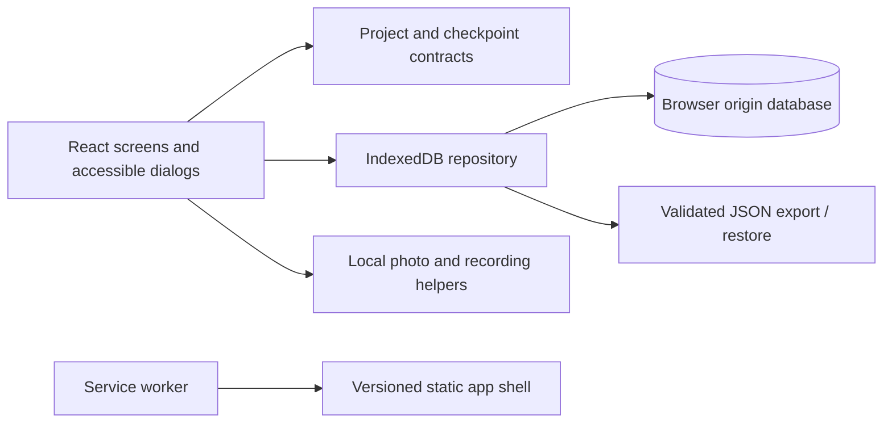

# Loopmark architecture

Design revision 2 — 18 October 2026. This document specifies the implemented local foundation's contracts and verification targets. Executed results belong in the final verification record. The subsequently accepted cloud, checkout and native scope is specified separately in [the expansion plan](expansion-plan.md); it is not implemented by this foundation.

## Product boundary

Loopmark is a single-person craft restart notebook: choose a project, record current position/tool/next step with optional media, and return directly to the latest checkpoint. History, a printable bag label, and complete export/restore support that journey. Authentication, cloud sync and payments are outside this local foundation and now accepted expansion work. Remote sharing, inventory and pattern marketplaces remain excluded. No paywall should pretend that a payment integration exists.

## Structure and dependencies

React owns form/display state; persistent data is authoritative in the repository. The domain module contains plain types and validation, never React or browser UI. The repository exposes asynchronous operations, hides IndexedDB, and has no rendering dependencies. Media is prepared before opening a write transaction. App-shell caches and user project data have separate lifecycles. Use small modules for these real responsibilities; avoid server layers, dependency-injection containers or speculative abstractions.

## Data contract

The TypeScript domain types are authoritative. V1 uses one stored project aggregate per project ID, with nested checkpoints. Projects carry ID, human-readable code, name, craft, color, yarn, tool size, notes, status, created/updated timestamps and checkpoint history. Craft is Crochet, Knitting or Other; status is active or finished. Colors are presentation tokens, never arbitrary CSS. IDs are generated independently from the readable bag code. Optional `sample: true` marks explicitly loaded example projects.

A checkpoint stores ID, created timestamp, position, tool size, next step, notes, and optional photo/voice media. Position is text because “round 8”, “repeat 3 of 6” and “heel turn” are all legitimate. Tool size is text for international conventions and mixed tools. Created times are ISO UTC strings; display uses local formatting. Store snapshots of tool size in each checkpoint to preserve historical changes.

The portable envelope is `{ format: 'loopmark', version: 1, exportedAt, projects }`. Media is embedded as validated bounded data URLs so one file contains everything. Restrict photos to safe raster types; never import arbitrary SVG or remote URLs. React renders project text normally; no HTML injection.

## Writes, concurrency and errors

- Read the current project and write the result within one IndexedDB `readwrite` transaction. Never save the entire UI's stale project collection back over the database.
- Appending a checkpoint reads the latest aggregate so simultaneous tabs retain both appends. Metadata edits and deletions compare the caller's expected `updatedAt` and report a conflict instead of silently overwriting later work.
- Checkpoint capture verifies active status inside the transaction. If another tab finishes the project while a capture form is open, saving asks the maker to reopen the project first.
- `updatedAt` is a concurrency token: take the later of the wall clock or the prior value plus one millisecond, so a stopped/backward clock cannot repeat a token. Only announce success after transaction `complete`; handle `abort`, errors, blocked opens and version changes. Close existing database connections on `versionchange` to permit upgrades.
- A small internal metadata watermark retains the latest mutation clock even through deletion or an empty restore. Reintroducing an old project ID from a backup cannot recreate a timestamp token still held by another tab.
- Do not await file reads, image decoding, timers, network requests or recording inside a live transaction. Validate and prepare those values beforehand.
- Notify other tabs after commit with a small invalidation message. Refresh on focus and after restore. Preserve an open draft when new data arrives; conflict resolution belongs to the explicit save action.
- A failed storage write retains the unsaved form and reports a useful retry/export message. Unavailable IndexedDB is an explicit failure; do not silently fall back to volatile memory and call it saved.

These rules follow the [IndexedDB transaction model](https://developer.mozilla.org/en-US/docs/Web/API/IndexedDB_API/Using_IndexedDB). Browser commit is not a promise against sudden device failure; backups define recoverability.

## Backup and restore

Export reads a coherent snapshot and includes all history/media. Restore validates the complete file before changing storage: recognized format/version, bounded counts and string sizes, valid enumerations and timestamps, unique project IDs/codes, unique checkpoint IDs, valid media types/base64 and total file size. Reject unsupported future versions rather than guessing. Never execute data from an imported file.

Restore replaces the local library only after a clear user confirmation showing the incoming project count and replacement consequence. Encourage an export first. Replacement is a single transaction containing `clear` plus all writes: any failed write aborts the entire replacement. Restore advances each project's `updatedAt` token beyond existing, imported and latest checkpoint dates, comparing numeric times, so already-open forms cannot overwrite it even after a wall-clock rollback. All user content, IDs, created dates, checkpoint timestamps and media are preserved; imported history is normalized newest-first for reliable resume. A normal project mutation arriving while restore is pending must either observe the replacement state or receive a missing/conflict error. The initial release deliberately avoids heuristic merges that could duplicate or discard checkpoints.

Opt-in example loading uses `seedSamples`, which checks that the library is empty and writes the validated examples in the same transaction. A simultaneous real-project creation can never be cleared by sample loading; the seeding operation fails harmlessly if another write populated the library first.

## Media and offline policy

Photo capture uses the ordinary file input with mobile capture as a hint. Decode before acceptance; orient/resize to at most 1600 pixels on the longest edge and encode raster output. Limits: 15 MiB source photo, 4 MiB decoded saved photo, 8 MiB decoded voice attachment, 120 seconds per recording, 50 MiB backup, 200 projects and 1,000 total checkpoints. Imported media is checked for allowed MIME, base64 syntax and complete bounded container structure; imported photos are decoded before replacement while audio remains codec-independent structural validation, not a full-stream codec decode. A metadata record tracks the library's serialized bytes/counts in the same transaction as each write. The library has a 48 MiB budget, leaving backup-envelope overhead beneath the import cap. Capacity errors preserve existing data and direct the user to export before removing older projects. Data URLs cost roughly one-third more than raw binary; revisit separate Blob stores if measured libraries make aggregate cloning slow.

Recording selects a supported MIME, ends tracks on stop/cancel/unmount, and reports denied/missing/unavailable microphone states. The next-step text remains the dependable cross-browser record. Stop recording cleanly if the UI is dismissed; do not leave a microphone running in the background.

Precache all build-generated JS/CSS and required local assets, including an offline navigation fallback. Cache version changes accompany builds. Avoid caching arbitrary remote requests or project data in the service worker. Never delete unrelated origin caches. An update waits until a safe reload/next open; do not interrupt a draft with unconditional activation. Advertise offline readiness only after successful installation. Normal development does not register a production worker that can mask source changes. See [service-worker lifecycle evidence](https://developer.mozilla.org/en-US/docs/Web/API/Service_Worker_API/Using_Service_Workers).

A label contains the project code and essential restart facts. Its QR payload is a URL to the project on the current app origin. It works only when that browser/profile already has the local record or restores its backup. A different phone/browser or changed domain/port cannot resolve the old data automatically. Show a useful missing-record explanation and offer restore when a label's ID is absent.

## Measurable quality targets

Targets are acceptance budgets, not claimed measurements. Measure the actual build and identify the browser/hardware used.

| Area | Target | Measurement |
|---|---|---|
| Capture usability | Returning user can save a text checkpoint in 30 seconds | Timed cohort task; report distribution, prompting and failures |
| UI response | Save feedback within 500 ms for text-only checkpoint, typical 20-project library | Browser timings, 20 projects / 200 text checkpoints |
| Cold loading | LCP <2.5 s, CLS <0.1 in a stated mobile lab profile | Lighthouse/trace; do not call lab timing real-user CWV |
| Delivery | Initial JS + CSS <250 KiB gzip; no remote fonts required | Build artifact size with compression |
| Media | Processed photo target <700 KiB; reject excessive inputs | Recorded fixture sizes and visible error tests |
| Accessibility | WCAG 2.2 AA target; keyboard, focus, labels, contrast and reduced motion | Automated checks plus manual journeys at 320 CSS px / zoom |
| Reliability | No partial restore and no lost concurrent checkpoint append | Transaction fault and two-tab tests |
| Recovery | Restore a 10-project/100-checkpoint backup with media in <5 s on tested desktop | Export/delete/restore round trip; compare fields and media |
| Privacy | Zero application-initiated transfer of project fields/media | Network inspection of create/save/export/restore |

## Architecture decisions

**ADR-001 — Static React/TypeScript/Vite.** Accepted. A focused local tool needs no server rendering, remote data cache or authentication. This simplifies hosting and operation while requiring explicit offline/routing choices. Reconsider a full framework if public content or server integrations become substantial. [Current React guidance](https://react.dev/learn/creating-a-react-app) permits this approach for suitable constraints.

**ADR-002 — IndexedDB aggregates and timestamp tokens.** Accepted. Per-project transactions provide a small reliable model; metadata conflicts are visible and checkpoint appends can safely rebase. Monotonic `updatedAt` values provide optimistic concurrency without a second revision field. Separate Blob/checkpoint stores would reduce copying at larger scale but require more referential and backup logic. Reconsider after profiling a large real library, not before.

**ADR-003 — Portable JSON with atomic replacement.** Accepted. A single self-contained file is inspectable and easy to transfer. It requires strict size limits and uses more memory than a streamed archive. Replace-only restore has clear semantics; multi-device sync/merge remains separate future work.

**ADR-004 — Device-local privacy and QR shortcut.** Accepted for the local foundation. No account or backend keeps the first experiment focused. Browser retention is best effort; exports are essential. QR labels contain no embedded media or cloud claim. The user's subsequent sync request requires the dedicated ownership/conflict design in the expansion plan; field demand remains unvalidated.

## Engineering review and test strategy

The architecture's critical risks are data loss from stale writes, partial restore, browser eviction, unsupported media, and service-worker updates interrupting capture. Unit tests cover validators, limits, malformed backups, unknown versions and unique IDs. Repository tests exercise actual IndexedDB semantics through a browser-compatible fake, including simultaneous append, stale metadata edits and rollback. Browser tests cover project creation, checkpoint/history, reload persistence, search/filter, completion/reactivation, print, export/restore, permission failure, missing QR record and offline reload after installation.

Visual/interaction checks cover narrow and wide layouts, long project names, dense histories, empty states, focus restoration, rapid clicks, busy states and reduced motion. Use real browser storage/worker tests for release claims; fake IndexedDB does not establish quota behavior or durable disk persistence. Real microphone/iOS testing and deployed-origin update checks remain explicitly unverified until executed. The selected test suite should focus on these risks rather than component internals.

## Completion-pass decisions

The current implementation adds an internal whole-library revision for restore confirmation, independent of timestamps. A preview made before another write cannot authorize deleting that later write. Explicit replacement can ignore unsupported legacy clock candidates while advancing beyond every supported existing/imported timestamp, preserving rollback and stale-token rejection.

Unfinished form recovery uses a separate version1 IndexedDB database (`loopmark-drafts`). It keeps text and prepared local media; drafts are outside portable saved-record backups. Compare-and-swap draft revisions protect concurrent tabs. Discard locks further editing; route/close guards await queued writes and stopped-recording conversion. Project deletion clears its draft keys. Save receipts in the original repository make unchanged retries idempotent when cross-database cleanup fails. Hashes and operation IDs never leave the browser.

Offline readiness is verified by a MessageChannel response from the active worker after checking every required asset. Generation guards ignore stale replies/timeouts. Failed installation and incomplete caches have explicit retry paths. A repair uses a new same-origin script URL to trigger installation; it does not force activation or clear project data. Waiting updates instruct users to save, close all app windows and reopen. Installation prompts appear only when the browser exposes an install event, with manual browser-menu guidance otherwise. See [MDN installation behavior](https://developer.mozilla.org/en-US/docs/Web/Progressive_web_apps/How_to/Trigger_install_prompt).
